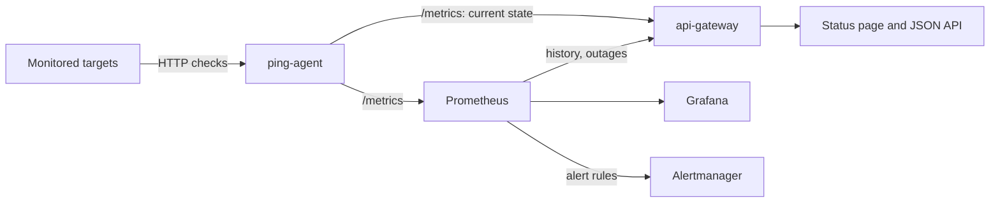
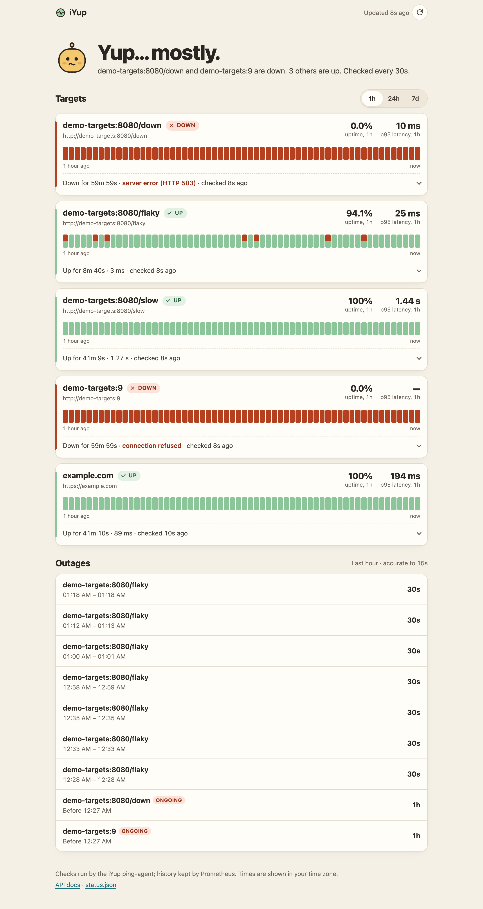
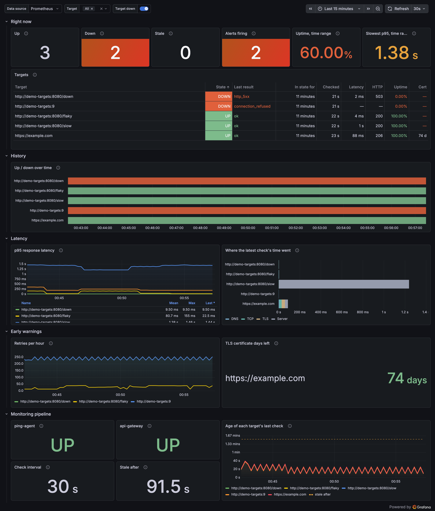

# iYup

I built iYup to show how a small monitoring stack fits together: active checks, Prometheus scraping, alert rules that are unit-tested, a status API and status page, a Grafana dashboard, Docker Compose, and Helm packaging.

It is not a SaaS clone. It is a small lab with real commands and a verification path you can rerun locally. The one rule it tries hard to keep: **never claim more than it knows**. A target with no data is `unknown`, not down. No checks means no availability number, not 0%. A stale check stops counting as current. Every failure says why it failed.

## What it does

- **Checks** HTTP(S) targets from a Go `ping-agent`, with retries and backoff. Each failure is classified (`timeout`, `dns`, `connection_refused`, `tls`, `http_4xx`, `http_5xx`, …) and the agent records DNS/TCP/TLS timings and certificate expiry.
- **Knows how fresh it is.** The agent publishes its own staleness budget, so the API and alerts can tell a stuck agent from a healthy target.
- **Alerts** on sustained failure, intermittent failure, stale checks, expiring certificates, and the monitor itself going down. Each rule's behaviour is pinned by `promtool` unit tests.
- **Serves a status page** at `/` and a typed JSON API (`/docs`): current state, uptime history, and detected outages.
- **Shows operators** a Grafana dashboard ordered by what to ask first: what is broken and why, since when, is it slow, is it getting flaky, and is the monitoring itself healthy.

## Run it

```bash
cp .env.example .env
docker compose up -d --build
./scripts/verify-local.sh
```

To see every state at once (up, slow, flaky, returning 503, refusing connections), add the demo overlay:

```bash
docker compose -f docker-compose.yml -f docker-compose.demo.yml up -d --build
```

Open:

- Status page: `http://localhost:8080`
- API docs: `http://localhost:8080/docs`
- Grafana: `http://localhost:3000` (opens on the iYup dashboard)
- Prometheus: `http://localhost:9090/alerts`
- Alertmanager: `http://localhost:9093`

If `.env` overrides host ports, use those values instead. More commands are in [docs/DEMO_COMMANDS.md](docs/DEMO_COMMANDS.md).

## System flow



The agent is the source of truth for "right now". Prometheus keeps history. The gateway discovers its target list from the agent, so the two cannot drift.

## API

| Endpoint | Purpose |
|---|---|
| `GET /` | status page |
| `GET /status` | overall state plus per-target state, reason, freshness, latency and certificate expiry |
| `GET /targets` | target list (discovered from the agent) |
| `GET /targets/{url}` | one target's status |
| `GET /history?window=24h&buckets=48` | uptime per time bucket, from Prometheus |
| `GET /outages?window=7d` | detected down periods with start, end and duration |
| `GET /uptime-summary` | check counts since the agent started |
| `GET /uptime-summary-windowed?window=5m` | check counts over a window, from Prometheus |
| `GET /healthz` | gateway liveness |
| `GET /metrics` | gateway metrics |

Contracts, states and error codes are in [docs/API.md](docs/API.md). The live OpenAPI schema is at `/docs`.

## Alerts

| Alert | Fires when | Severity |
|---|---|---|
| `TargetDown` | every check has failed for 1m (it rides out agent restarts) | critical |
| `TargetUnreliable` | keeps flipping between up and down: under 90% up over 15m with more than one outage (suppressed while `TargetDown` fires) | warning |
| `TargetChecksStale` | the agent is running but checks stopped finishing | warning |
| `CertificateExpiringSoon` | a TLS certificate expires within 14 days | warning |
| `PingAgentDown` | Prometheus cannot scrape the agent, so nothing is being checked | critical |
| `ApiGatewayDown` | the status API is down | warning |

What to do for each one is in [docs/OPERATIONS_RUNBOOK.md](docs/OPERATIONS_RUNBOOK.md).

## Configuration

| Variable | Default | Purpose |
|---|---|---|
| `PING_TARGET_URLS` | `https://google.com,https://github.com` | comma-separated absolute http(s) URLs; invalid entries stop the agent at startup |
| `PING_INTERVAL_SECONDS` | `30` | pause between check cycles |
| `PING_TIMEOUT_SECONDS` | `10` | per-attempt timeout |
| `PING_RETRY_COUNT` | `2` | retries before a check counts as failed (`0` disables retries) |
| `PING_CONCURRENCY` | `5` | parallel checks |
| `PING_HTTP_METHOD` | `GET` | `GET` or `HEAD` |
| `PROMETHEUS_QUERY_CACHE_SECONDS` | `15` | gateway cache for history queries |
| `API_GATEWAY_PORT`, `PING_AGENT_PORT`, `PROMETHEUS_PORT`, `GRAFANA_PORT`, `ALERTMANAGER_PORT` | `8080`, `18080`, `9090`, `3000`, `9093` | host ports |
| `GRAFANA_PASSWORD` | `admin` | Grafana admin password in Docker Compose |

Setting `PING_TARGET_URLS` on the gateway is optional. If you set it, the gateway reports exactly those URLs in that order. If you don't, it reports whatever the agent checks.

## Verification

| Check | Command |
|---|---|
| Go tests (race detector) | `cd services/ping-agent && go test -race ./...` |
| Gateway tests | `pip install -r services/api-gateway/requirements-dev.txt && python -m unittest discover -s services/api-gateway -p "test*.py"` |
| Alert rule unit tests | `docker run --rm -v "$PWD/config:/c:ro" --entrypoint promtool prom/prometheus:v2.54.1 test rules /c/alert.rules.test.yml` |
| Running stack | `./scripts/verify-local.sh` |
| Every dashboard query against live data | `python3 scripts/check_dashboard_queries.py http://localhost:9090` |
| Failure replays | `./scripts/reliability/down-target-demo.sh`, `./scripts/reliability/transient-target-demo.sh` |

CI runs the Go, gateway and alert-rule tests plus config, Compose and Helm checks. The running-stack checks and the replays need Docker locally. What is proven and how is tracked in [docs/PORTFOLIO_PROOF_CHECKLIST.md](docs/PORTFOLIO_PROOF_CHECKLIST.md).

## Screenshots




Full set, captured from the stack with the demo overlay:

- [01 repo overview](docs/screenshots/01-repo-overview.png)
- [02 Docker Compose stack](docs/screenshots/02-docker-compose-stack.png)
- [03 API health check](docs/screenshots/03-api-healthz.png)
- [04 status API with states and reasons](docs/screenshots/04-api-status-response.png)
- [05 Prometheus targets](docs/screenshots/05-prometheus-targets.png)
- [06 latest result per target in Prometheus](docs/screenshots/06-prometheus-metrics.png)
- [07 Grafana dashboard](docs/screenshots/07-grafana-dashboard.png)
- [08 Alertmanager with firing alerts](docs/screenshots/08-alertmanager.png)
- [09 Helm template output](docs/screenshots/09-helm-template.png)
- [10 local verification script](docs/screenshots/10-local-verification.png)
- [11 status page](docs/screenshots/11-status-page.png)

How each one is captured is in [docs/SCREENSHOT_GUIDE.md](docs/SCREENSHOT_GUIDE.md).

## Limitations

- one agent, one vantage point: no multi-region quorum, so a network problem near the agent looks like an outage
- no notification credentials ship with the repo; Compose alerts stop at Alertmanager, Helm sends them to an in-cluster log receiver plus email/Slack when configured
- current-state data that is "since the agent started" (lifetime counts and percentiles) resets when the agent restarts; history comes from Prometheus and survives
- outage times are accurate to one Prometheus step (15s for windows up to about 41 hours, coarser beyond)
- no incident workflow (acknowledging, notes, maintenance windows)
- no tracing or log aggregation
- Helm is render-validated here, not cluster-validated

## Docs

- [docs/QUICKSTART.md](docs/QUICKSTART.md)
- [docs/API.md](docs/API.md)
- [docs/ARCHITECTURE.md](docs/ARCHITECTURE.md)
- [docs/OPERATIONS_RUNBOOK.md](docs/OPERATIONS_RUNBOOK.md)
- [docs/RELIABILITY_SCENARIOS.md](docs/RELIABILITY_SCENARIOS.md)
- [docs/GRAFANA.md](docs/GRAFANA.md)
- [docs/DEPLOYMENT.md](docs/DEPLOYMENT.md)
- [docs/TROUBLESHOOTING.md](docs/TROUBLESHOOTING.md)
- [docs/DEMO_COMMANDS.md](docs/DEMO_COMMANDS.md)
- [docs/SCREENSHOT_GUIDE.md](docs/SCREENSHOT_GUIDE.md)
- [docs/PORTFOLIO_PROOF_CHECKLIST.md](docs/PORTFOLIO_PROOF_CHECKLIST.md)
- [docs/PHASE_0_VERIFICATION.md](docs/PHASE_0_VERIFICATION.md)
