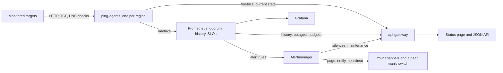

# iYup

I built iYup to show how a small monitoring stack fits together, done the way an experienced operator would run it: checks as code, a majority vote across regions, alert rules that are unit-tested, error budgets, a heartbeat for the alerting pipeline itself, planned maintenance, a status page, a Grafana dashboard, Docker Compose, and Helm packaging.

It is not a SaaS clone. It is a small lab with real commands and a verification path you can rerun locally. The one rule it tries hard to keep: **never claim more than it knows**. A target with no data is `unknown`, not down. No checks means no availability number, not 0%. A stale check stops counting as current. A failure seen from one region is not an outage. Every failure says why it failed.

## What it does

- **Checks as code.** `config/targets/targets.yml` defines HTTP(S), TCP (optionally with TLS) and DNS checks, each with its own interval, timeout, retries, headers (secrets read from the environment), expected status codes, required response text, a "slow" threshold and an availability objective. CI validates the file.
- **Classifies every failure** (`timeout`, `dns`, `connection_refused`, `tls`, `http_5xx`, `body_mismatch`, `unexpected_answer`, …) and records DNS/TCP/TLS timings, certificate expiry and domain registration expiry.
- **Votes across regions.** Run several agents with different `PING_REGION`s: a target is down only when most regions agree; a failure seen from a minority is a regional warning, not a page.
- **Alerts like a seasoned on-call setup:** sustained outages, error-budget burn (the multi-window method from Google's SRE workbook), slowness, regional failures, stale checks, expiring certificates and domains, and the monitor itself going down. Each rule's behaviour is pinned by `promtool` unit tests.
- **Routes alerts by severity.** Critical alerts page; warnings notify; an always-firing heartbeat feeds an external dead man's switch, so a dead monitoring stack can't look like a quiet day. A script sends a test alert to prove your channels work.
- **Plans maintenance.** One command mutes a target's alerts and announces the window on the status page.
- **Serves a status page** at `/` and a typed JSON API (`/docs`): current state by region, uptime history, outages, error budgets and maintenance.
- **Shows operators** a Grafana dashboard ordered by what to ask first: what is broken and why, since when, from where, how much budget is left, is it slow, what is about to expire, and is the monitoring itself healthy.

## Run it

```bash
cp .env.example .env
docker compose up -d --build
./scripts/verify-local.sh
```

To see every state at once (slow, flaky, wrong content, failing from one region, refusing connections) with two agents standing in for two regions, add the demo overlay:

```bash
docker compose -f docker-compose.yml -f docker-compose.demo.yml up -d --build
docker compose logs -f demo-targets     # the notifications the demo "receives"
```

Open:

- Status page: `http://localhost:8080`
- API docs: `http://localhost:8080/docs`
- Grafana: `http://localhost:3000` (opens on the iYup dashboard)
- Prometheus: `http://localhost:9090/alerts`
- Alertmanager: `http://localhost:9093`

If `.env` overrides host ports, use those values instead. More commands are in [docs/DEMO_COMMANDS.md](docs/DEMO_COMMANDS.md).

## System flow



The agents are the source of truth for "right now". Prometheus keeps history and computes the region quorum and error budgets with recording rules, so alerts, the API and the dashboard share one definition of "up". The gateway discovers targets from the agents, so they cannot drift.

## API

| Endpoint | Purpose |
|---|---|
| `GET /` | status page |
| `GET /status` | overall state, and per target: majority verdict, per-region results, reason, slowness, freshness, latency, certificate expiry, maintenance |
| `GET /targets`, `GET /targets/{id}` | target list (discovered from the agents) and one target's status |
| `GET /history?window=24h&buckets=48` | uptime per time bucket |
| `GET /outages?window=7d` | down periods with start, end and duration |
| `GET /slo?window=30d` | error budget per target: allowed and used downtime, budget left, burn rate |
| `GET /uptime-summary`, `GET /uptime-summary-windowed?window=5m` | check counts |
| `GET /healthz`, `GET /metrics` | gateway liveness and metrics |

Contracts, states and error codes are in [docs/API.md](docs/API.md). The live OpenAPI schema is at `/docs`.

## Alerts

| Alert | Fires when | Severity |
|---|---|---|
| `TargetDown` | a majority of regions see every check fail for 1m (rides out agent restarts) | critical |
| `ErrorBudgetBurnFast` | the 30-day error budget is being spent 14.4x (1h and 5m) or 6x (6h and 30m) too fast | critical |
| `ErrorBudgetBurnSlow` | the budget will not last the month (3d and 6h) | warning |
| `TargetRegionalFailure` | some regions fail for 5m while most succeed | warning |
| `TargetSlow` | most regions see the target slower than its threshold for 5m | warning |
| `TargetChecksStale` | an agent is running but its checks stopped finishing | warning |
| `CertificateExpiringSoon` | a TLS certificate expires within 14 days | warning |
| `DomainExpiringSoon` | a domain registration expires within 30 days | warning |
| `AllPingAgentsDown` / `PingAgentDown` | no agent / one agent can be scraped | critical / warning |
| `ApiGatewayDown` | the status API is down | warning |
| `Watchdog` | always: the heartbeat for an external dead man's switch | none |

Routing, receivers, the heartbeat and maintenance windows are in [docs/ALERTING.md](docs/ALERTING.md). What to do for each alert is in [docs/OPERATIONS_RUNBOOK.md](docs/OPERATIONS_RUNBOOK.md).

## Configuration

Targets live in [`config/targets/targets.yml`](config/targets/targets.yml); every field is described in [docs/CONFIGURATION.md](docs/CONFIGURATION.md). A minimal target:

```yaml
targets:
  - name: API health
    url: https://api.example.com/health
    expect:
      body_contains: '"status":"ok"'
    degraded_after: 800ms
    slo: 99.95
```

Setting `PING_TARGET_URLS` in `.env` overrides the file with a plain URL list. Alert receivers go in a git-ignored copy of `config/alertmanager.yml` (`ALERTMANAGER_CONFIG`). Host ports, retention and the other environment variables are listed in the configuration guide.

## Verification

| Check | Command |
|---|---|
| Go tests (race detector) | `cd services/ping-agent && go test -race ./...` |
| Targets files | `cd services/ping-agent && go run . validate ../../config/targets/targets.yml` |
| Gateway tests | `pip install -r services/api-gateway/requirements-dev.txt && python -m unittest discover -s services/api-gateway -p "test*.py"` |
| Alert rule unit tests | `docker run --rm -v "$PWD/config:/c:ro" --entrypoint promtool prom/prometheus:v2.54.1 test rules /c/alert.rules.test.yml` |
| Running stack | `./scripts/verify-local.sh` |
| Every dashboard query against live data | `python3 scripts/check_dashboard_queries.py http://localhost:9090` |
| Notifications reach you | `./scripts/send-test-alert.py` |
| Failure replays | `./scripts/reliability/down-target-demo.sh`, `./scripts/reliability/transient-target-demo.sh` |

CI runs the Go, gateway and alert-rule tests, validates the targets files, and checks the Prometheus, Alertmanager, Compose and Helm configuration. The running-stack checks and replays need Docker locally. What is proven and how is tracked in [docs/PORTFOLIO_PROOF_CHECKLIST.md](docs/PORTFOLIO_PROOF_CHECKLIST.md).

## Screenshots


Full set, captured from the stack with the demo overlay:

- [01 repo overview](docs/screenshots/01-repo-overview.png)
- [02 Docker Compose stack](docs/screenshots/02-docker-compose-stack.png)
- [03 API health check](docs/screenshots/03-api-healthz.png)
- [04 status API with regions and reasons](docs/screenshots/04-api-status-response.png)
- [05 Prometheus targets](docs/screenshots/05-prometheus-targets.png)
- [06 latest result per target and region in Prometheus](docs/screenshots/06-prometheus-metrics.png)
- [07 Grafana dashboard](docs/screenshots/07-grafana-dashboard.png)
- [08 Alertmanager routing, with a maintenance silence](docs/screenshots/08-alertmanager.png)
- [09 Helm lint and checks as code rendered by the chart](docs/screenshots/09-helm-template.png)
- [10 local verification script](docs/screenshots/10-local-verification.png)
- [11 status page](docs/screenshots/11-status-page.png)

How each one is captured is in [docs/SCREENSHOT_GUIDE.md](docs/SCREENSHOT_GUIDE.md).

## Limitations

- the demo's two regions run on one machine; real geographic diversity means running agents in different places (for example two cheap VMs or Fly.io regions) and scraping them all
- one Prometheus and one Alertmanager: no high availability for the monitoring stack itself; the heartbeat makes their failure visible, not survivable
- HTTP checks are single requests; there are no scripted multi-step (browser) journeys
- no ICMP ping: it needs raw-socket privileges, and a TCP check answers the same question for most services
- maintenance windows mute alerts and set targets aside on the status page, but downtime during them still counts against the error budget
- current-state counts "since the agent started" (lifetime checks and percentiles) reset when an agent restarts; history comes from Prometheus and survives
- outage times are accurate to one Prometheus step (15s for windows up to about 41 hours, coarser beyond)
- no incident timeline or acknowledgement workflow beyond what Alertmanager provides
- Helm is render-validated here, not cluster-validated

## Docs

- [docs/QUICKSTART.md](docs/QUICKSTART.md)
- [docs/CONFIGURATION.md](docs/CONFIGURATION.md)
- [docs/ALERTING.md](docs/ALERTING.md)
- [docs/API.md](docs/API.md)
- [docs/ARCHITECTURE.md](docs/ARCHITECTURE.md)
- [docs/OPERATIONS_RUNBOOK.md](docs/OPERATIONS_RUNBOOK.md)
- [docs/RELIABILITY_SCENARIOS.md](docs/RELIABILITY_SCENARIOS.md)
- [docs/GRAFANA.md](docs/GRAFANA.md)
- [docs/DEPLOYMENT.md](docs/DEPLOYMENT.md)
- [docs/TROUBLESHOOTING.md](docs/TROUBLESHOOTING.md)
- [docs/DEMO_COMMANDS.md](docs/DEMO_COMMANDS.md)
- [docs/SCREENSHOT_GUIDE.md](docs/SCREENSHOT_GUIDE.md)
- [docs/PORTFOLIO_PROOF_CHECKLIST.md](docs/PORTFOLIO_PROOF_CHECKLIST.md)
- [docs/PHASE_0_VERIFICATION.md](docs/PHASE_0_VERIFICATION.md)
