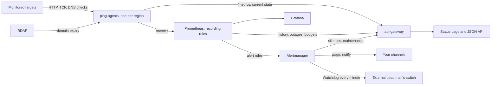

# Architecture

This repo has two runtime paths:

- Docker Compose for local proof and screenshots
- Helm for Kubernetes packaging and render checks

## Runtime flow

## Components

| Component | What it does | Main files |
|---|---|---|
| `ping-agent` (Go) | loads checks as code, runs each on its own schedule, classifies failures, watches domain expiry, exposes metrics | `services/ping-agent/{targets,config,scheduler,probe,netchecks,domains,metrics,main}.go` |
| `api-gateway` (Python, FastAPI) | status page; current state voted across agents; history, outages and budgets from Prometheus; maintenance from Alertmanager | `services/api-gateway/{main,snapshot,promql,maintenance,schemas}.py`, `static/` |
| Prometheus | scrapes everything, keeps 35 days, computes the region quorum and error ratios, evaluates alerts every 15s | `config/prometheus.yml`, `config/agents.yml`, `config/alert.rules.yml` |
| Alertmanager | routes by severity, inhibits redundant alerts, sends the heartbeat, holds maintenance silences | `config/alertmanager.yml` |
| Grafana | operator dashboard | `monitoring/grafana-dashboard.json`, `config/grafana-*.yml` |
| Helm chart | packages the stack, plus an in-cluster alert log receiver | `charts/iyup/` |
| Scripts | maintenance windows, test alerts, live checks, failure replays | `scripts/` |

## How a check becomes a verdict

1. At startup the agent loads `config/targets/targets.yml` (or `PING_TARGET_URLS`). Every problem in the file is reported at once and stops the agent; a monitor that silently drops a target is worse than one that refuses to start.
2. Each target runs in its own loop on its own `interval`. A shared semaphore caps checks in flight at `PING_CONCURRENCY`. First checks are spread over two seconds so a restart does not fire everything at once. A slow target never pushes back the others' schedules, though while it runs it holds one of those slots. If one check outlasts its interval, the next starts immediately, with an `[OVERRUN]` log line.
3. Every attempt has its own `timeout`. Failures a second attempt might fix (timeouts, refused or reset connections, DNS errors, 5xx, body mismatches) are retried with exponential backoff; a 4xx, a rejected certificate or a wrong DNS answer is not.
4. The outcome is classified into a closed set of reasons, so it is safe as a metric label. A successful check slower than `degraded_after` is marked slow.
5. The recorder updates the metrics: up/down, slow, last result, status code, latency (only when a response arrived), connection phases (only those that completed), certificate expiry, retries, last-check time and state-change time.
6. If the check was interrupted by shutdown, nothing is recorded. An interrupted check says nothing about the target.

## From many regions to one answer

Each agent sets `PING_REGION`, which becomes a `region` label on its metrics. Prometheus recording rules turn the per-region results into one verdict per target:

| Series | Meaning |
|---|---|
| `iyup:target_regions:count` | regions with a recent result (`last_over_time(ping_up[2m])` bridges an agent restart) |
| `iyup:target_regions_up:count` | regions whose latest check succeeded |
| `iyup:target_up:quorum` | 1 when at least half of those regions see the target up, else 0 |
| `iyup:target_degraded:quorum` | 1 when most regions that reach the target find it slow |
| `iyup:target_availability:avg5m` | quorum availability over 5 minutes, the base for long windows |
| `iyup:target_slo:objective` | the target's configured objective, as a ratio |
| `iyup:target_error_ratio:rate{5m,30m,1h,6h,3d}` | share of each window spent down, for the burn-rate alerts |

Ties count as up. With two regions, one failing is a regional problem (`TargetRegionalFailure`), not an outage; both failing is `TargetDown`. With a single agent the quorum is just `ping_up`.

The alerts, `/history`, `/outages`, `/slo` and the dashboard all read these series, so there is one definition of "up". The gateway applies the same majority rule to the agents' live metrics for the current state, so the status page does not wait for a Prometheus scrape.

## Design decisions

**Unknown is a state.** A target is `up` or `down` only when there is a fresh check to back it. Before the first check, after a config drift, or when no region finishes checks any more, it is `unknown`. The overall status refuses to say `operational` while anything is unknown.

**Checks as code, validated before they run.** Targets, assertions and objectives live in one YAML file under version control. Unknown fields are errors, so a typo cannot quietly disable an assertion. `ping-agent validate` checks a file without starting anything, and CI runs it on every file in `config/targets/`. Header values read `${VAR}` from the environment; target ids keep the placeholder, so a secret can never end up in a metric label.

**Up means the right answer, not just an answer.** A login page served with `200` instead of the API, or a DNS record pointing somewhere else, is down. HTTP checks can require specific status codes and response text; DNS checks can require answers.

**The agent publishes its own budgets.** `ping_stale_after_seconds` is two intervals plus one worst-case check (every attempt timing out, every backoff served). The agent alone knows each target's timeout, retries and backoff, so it computes the number, and the gateway and `TargetChecksStale` read it instead of guessing. Likewise `ping_degraded_threshold_seconds` and `ping_slo_objective_ratio` carry each target's slow threshold and objective, so Prometheus rules need no per-target configuration.

**Alerts on the verdict, not on failure counts.** `TargetDown` is `iyup:target_up:quorum == 0` for 1 minute. It works at any check interval, rides out the gap an agent restart causes (so a deploy does not resolve the alert and page again a minute later), and resolves on the first successful check from a majority.

**Error budgets catch what outage alerts cannot.** A target failing every other check never stays down for a full minute, so `TargetDown` never fires, yet users see constant errors. The burn-rate alerts follow the multi-window method from Google's SRE workbook. Each error ratio divides observed downtime by the whole window, so a young install or a scrape gap counts as "unknown", not as "down": one failed check on a ten-minute-old install is not a 74x burn. The fast-burn alert stays quiet about an outage `TargetDown` already paged for while that outage is still inside its short window. Behaviour is pinned by `config/alert.rules.test.yml`.

**The monitor watches itself.** `Watchdog` always fires and Alertmanager forwards it every minute to an external dead man's switch. If Prometheus, Alertmanager, the machine or the network fails, the heartbeat stops and the external service alerts. Nothing inside a stack can report its own death.

**Maintenance is an Alertmanager silence.** A window is a silence on the target's alerts with a comment starting `[maintenance]`. That keeps one source of truth, survives restarts in Alertmanager's data volume, and needs no database. The gateway reads silences to show windows on the status page; unmarked silences stay private. Downtime during a window still counts against the error budget: users were still affected.

**History from the quorum.** History buckets average `iyup:target_up:quorum`. Outages use `min_over_time` over each step, so a single failed check is caught however coarse the step. Both read the post-retry, majority verdict, so a blip a retry absorbed, or a failure from one region, is not downtime.

**One target list.** The agents export `ping_target_info` from startup and the gateway discovers targets from it. Before this, both services read `PING_TARGET_URLS` separately, and any mismatch reported real targets as down with zero checks.

**One copy of shared config.** `charts/iyup/files/` holds symlinks to `config/alert.rules.yml`, `config/grafana-dashboards.yml` and `monitoring/grafana-dashboard.json`. Helm resolves the links when rendering and packaging, so Compose and Kubernetes cannot drift. Helm's `checks` value uses the same format as the targets file.

## Metrics exported by the agent

Per target (label `target`), plus `region` when `PING_REGION` is set:

| Metric | Type | Notes |
|---|---|---|
| `ping_up` | gauge | 1 up, 0 down, from the latest check |
| `ping_degraded` | gauge | 1 when up but slower than `degraded_after` |
| `ping_last_result{reason}` | gauge | exactly one reason per target, value 1 |
| `ping_last_status_code` | gauge | HTTP only; absent when no response arrived |
| `ping_last_latency_seconds` | gauge | absent when no response arrived |
| `ping_latency_seconds` | histogram | responses only; buckets dense between 0.1s and 3s |
| `ping_success_total`, `ping_failure_total` | counters | one per check, after retries |
| `ping_retries_total` | counter | early sign of a flaky target |
| `ping_last_check_timestamp_seconds` | gauge | when the latest check finished |
| `ping_state_change_timestamp_seconds` | gauge | when up/down last flipped |
| `ping_ssl_cert_expiry_days` | gauge | HTTPS and `tls: true` checks; negative once expired |
| `ping_{dns,connect,tls}_duration_seconds` | gauges | latest check; absent if the phase did not complete |
| `ping_target_info{name,kind}` | gauge | configured targets, present from startup |
| `ping_interval_seconds`, `ping_stale_after_seconds` | gauges | the target's timing budget |
| `ping_degraded_threshold_seconds` | gauge | present only when `degraded_after` is set |
| `ping_slo_objective_ratio` | gauge | e.g. 0.999 |

Per domain (label `domain`): `ping_domain_expiry_days`, `ping_domain_expiry_last_check_timestamp_seconds` and `ping_domain_expiry_errors_total`. Domains are looked up over RDAP twice a day, with retries backing off from 5 minutes after a failed lookup.

## Helm

The chart packages `ping-agent`, `api-gateway`, Prometheus (with the same rules), Grafana (with the datasource and dashboard provisioned), Alertmanager (with a volume for silences), `alert-logger`, and an optional ingress. Checks come from the `checks` value, rendered into a ConfigMap, or from the plain `pingTargets` list.

Alertmanager does not expand environment variables in its config. The chart therefore renders `alertmanager.yml` from values into a Secret, with the same routes and inhibitions as `config/alertmanager.yml`. Every alert also goes to `alert-logger`; email, Slack, Discord, Telegram, a generic webhook and the heartbeat URL are added only when configured.

Prometheus, Alertmanager, Grafana and the agent read their config only at startup. Each pod template therefore carries a checksum of that config, so a `helm upgrade` that changes checks, rules, receivers or the dashboard rolls the pod instead of leaving the old config running.

The screenshot proof covers Docker Compose. The Helm side is render-validated (`helm lint`, `helm template`, and `amtool`/`promtool` checks on the rendered output), not cluster-validated.
