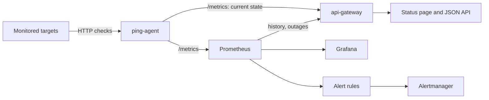

# Architecture

This repo has two runtime paths:

- Docker Compose for local proof and screenshots
- Helm for Kubernetes packaging and render checks

## Runtime flow

## Components

| Component | What it does | Main files |
|---|---|---|
| `ping-agent` (Go) | runs checks, classifies failures, exposes metrics | `services/ping-agent/{config,probe,metrics,main}.go` |
| `api-gateway` (Python, FastAPI) | status page, current state from the agent, history from Prometheus | `services/api-gateway/{main,snapshot,promql,schemas}.py`, `static/` |
| Prometheus | scrapes both services, keeps history, evaluates rules every 15s | `config/prometheus.yml`, `config/alert.rules.yml` |
| Alertmanager | routes alerts, suppresses `TargetUnreliable` while `TargetDown` fires | `config/alertmanager.yml` |
| Grafana | operator dashboard | `monitoring/grafana-dashboard.json`, `config/grafana-*.yml` |
| Helm chart | packages the stack, plus an in-cluster alert log receiver | `charts/iyup/` |

## How a check becomes a verdict

1. The scheduler starts a cycle right away and then every `PING_INTERVAL_SECONDS`. Cycles never overlap. If a cycle runs long, the next one starts as soon as it ends.
2. A bounded worker pool checks each target. Every attempt has its own `PING_TIMEOUT_SECONDS`. Transport errors and `5xx` are retried with exponential backoff; `4xx` are not.
3. The final outcome is classified into a closed set of reasons, so it is safe to use as a metric label.
4. The recorder updates the metrics: up/down, last result, status code, latency (only when a response arrived), connection phases (only those that completed), certificate expiry, retries, last-check time, and state-change time.
5. If the check was interrupted by shutdown, nothing is recorded. An interrupted check says nothing about the target.

## Design decisions

**Unknown is a state.** A target is `up` or `down` only when there is a fresh check to back it. Before the first check, after a config drift, or when the agent stops finishing checks, it is `unknown`. The overall status refuses to say `operational` while anything is unknown.

**The agent publishes its own freshness budget.** `ping_stale_after_seconds` is two intervals plus one worst-case check (every attempt timing out, every backoff served). The agent is the only component that knows its timeout, retry and backoff settings, so it computes the number. The gateway and the `TargetChecksStale` alert both read it instead of guessing.

**No deadline per cycle.** An earlier version gave each cycle a deadline equal to the interval. A slow target could then be cut off mid-check and recorded as down, and targets queued behind it were skipped without a trace. Now every attempt has its own deadline. A slow target can only delay the cycle, and that delay shows up as staleness.

**One target list.** The agent exports `ping_target_info` from startup and the gateway discovers targets from it. Before this, both services read `PING_TARGET_URLS` separately, and any mismatch reported real targets as down with zero checks.

**Alerts on the verdict, not on failure counts.** `TargetDown` uses `last_over_time(ping_up[2m]) == 0`:
- It works at any check interval. The old failures-per-minute rule could not fire at all once the interval reached 40s.
- It rides out the staleness gap an agent restart causes, so a deploy no longer resolves the alert and pages again a minute later.
- It still resolves on the first successful check.

Behaviour is pinned by `config/alert.rules.test.yml`.

**History from `ping_up`.** History buckets use `avg_over_time(ping_up)`, the share of samples that were up. Outages use `min_over_time(ping_up[step])`, so a single failed check is caught however coarse the step. Both read the post-retry verdict, so a blip that a retry absorbed is not downtime.

**One copy of shared config.** `charts/iyup/files/` holds symlinks to `config/alert.rules.yml`, `config/grafana-dashboards.yml` and `monitoring/grafana-dashboard.json`. Helm resolves the links when rendering and packaging, so Compose and Kubernetes cannot drift.

## Metrics exported by the agent

| Metric | Type | Notes |
|---|---|---|
| `ping_up` | gauge | 1 up, 0 down, from the latest check |
| `ping_last_result{reason}` | gauge | exactly one reason per target, value 1 |
| `ping_last_status_code` | gauge | absent when no response arrived |
| `ping_last_latency_seconds` | gauge | absent when no response arrived |
| `ping_latency_seconds` | histogram | responses only; buckets dense between 0.1s and 3s |
| `ping_success_total`, `ping_failure_total` | counters | one per check, after retries |
| `ping_retries_total` | counter | early sign of a flaky target |
| `ping_last_check_timestamp_seconds` | gauge | when the latest check finished |
| `ping_state_change_timestamp_seconds` | gauge | when up/down last flipped |
| `ping_ssl_cert_expiry_days` | gauge | negative once expired |
| `ping_{dns,connect,tls}_duration_seconds` | gauges | latest check; absent if the phase did not complete |
| `ping_target_info` | gauge | configured targets, present from startup |
| `ping_interval_seconds`, `ping_stale_after_seconds` | gauges | the agent's timing budget |

With `PING_REGION` set, every metric carries a `region` label, so several agents can share one Prometheus.

## Helm

The chart packages `ping-agent`, `api-gateway`, Prometheus (with the same rules), Grafana (with the datasource and dashboard provisioned), Alertmanager, `alert-logger`, and optional ingress and HPA resources.

Alertmanager does not expand environment variables in its config. The chart therefore renders `alertmanager.yml` from values into a Secret. Every alert goes to `alert-logger`, and email or Slack receivers are added only when they are configured.

Prometheus, Alertmanager and Grafana read their config only at startup. Each pod template therefore carries a checksum of that config, so a `helm upgrade` that changes rules, receivers or the dashboard rolls the pod instead of leaving the old config running.

The screenshot proof covers Docker Compose. The Helm side is render-validated (`helm lint`, `helm template`, and `amtool`/`promtool` checks on the rendered output), not cluster-validated.
